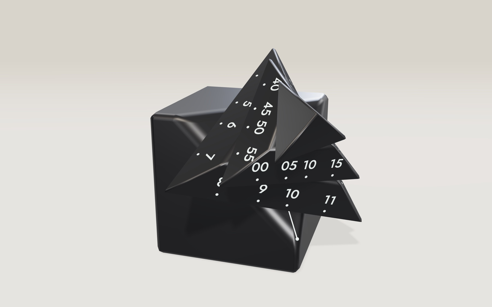
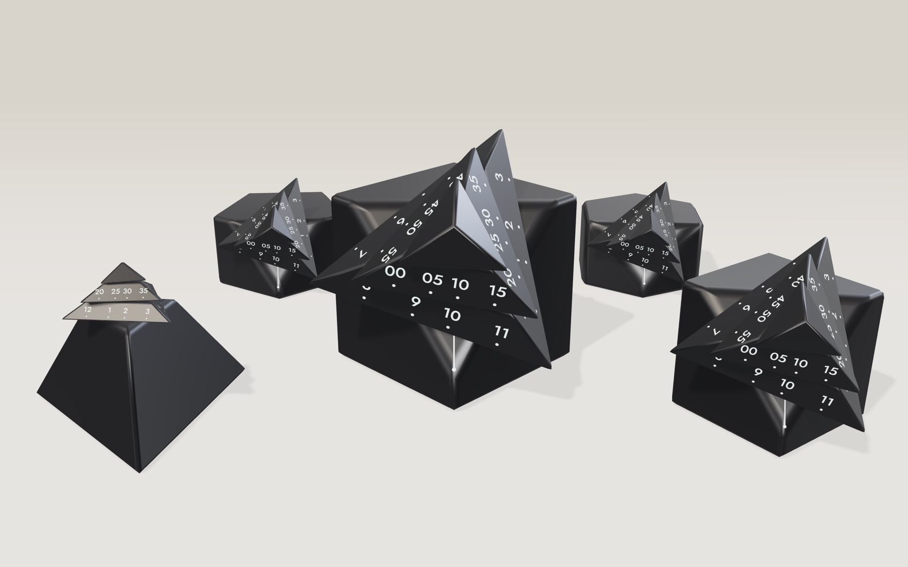
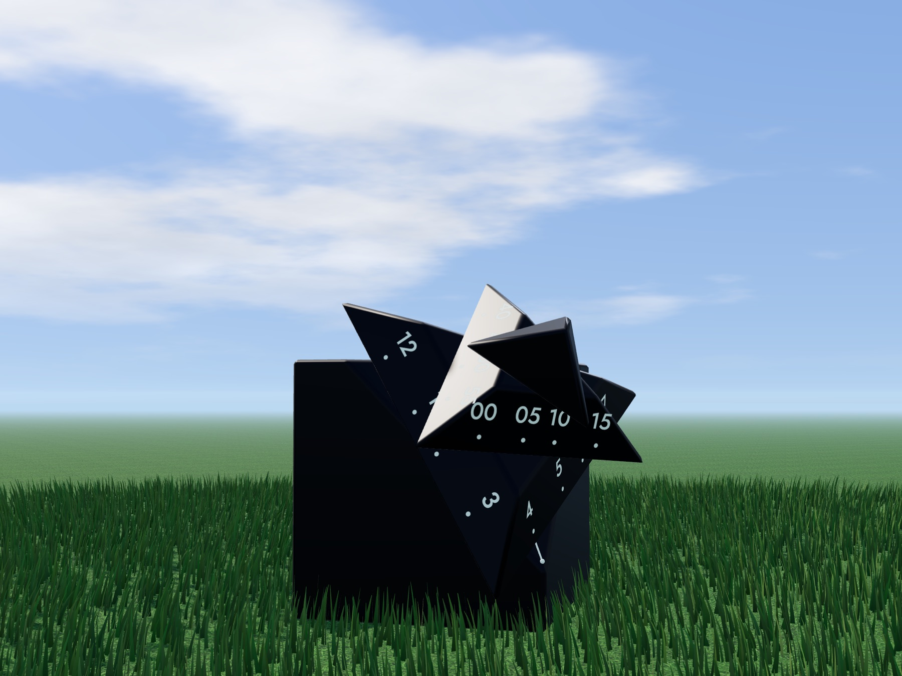
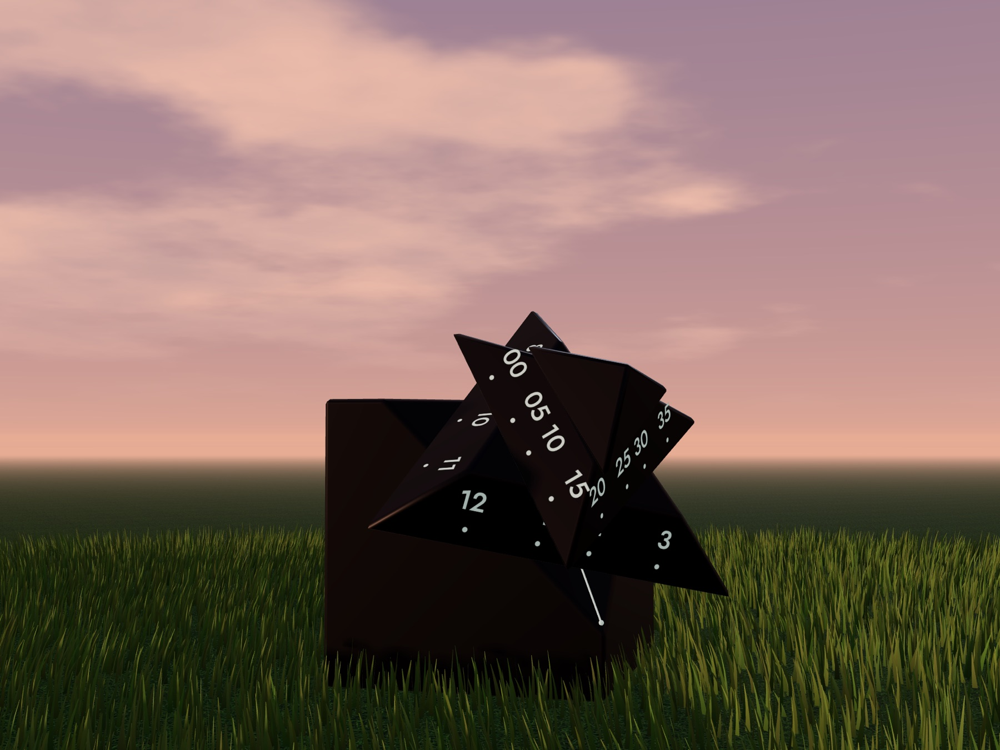
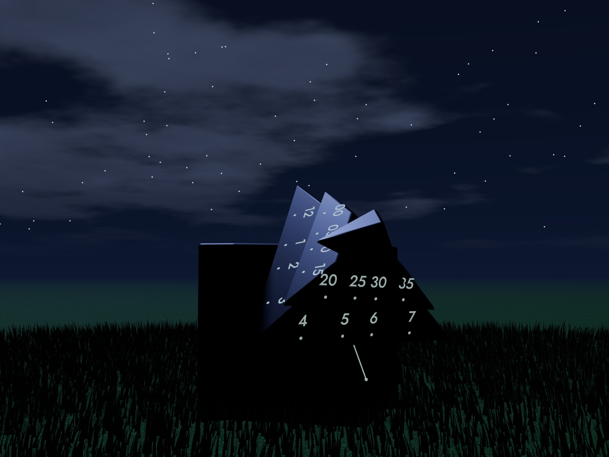
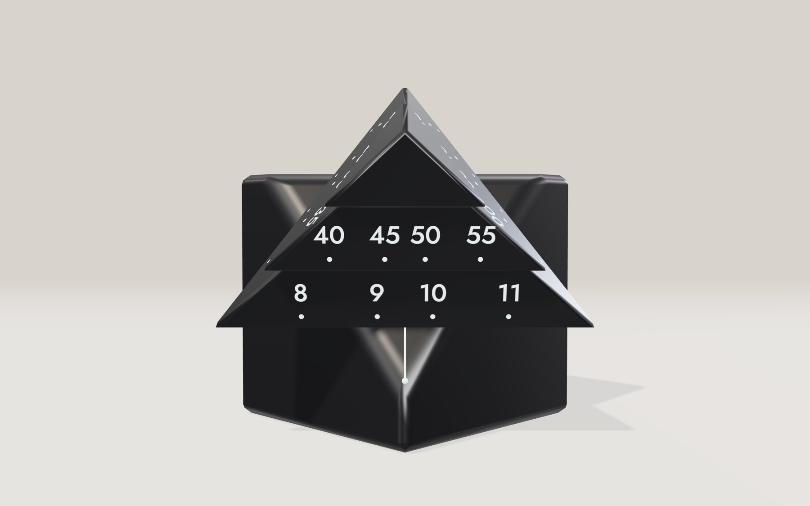
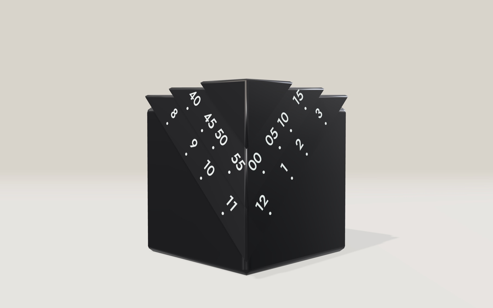

# Polytock

A WebGL model of [@sushi_watches](https://www.instagram.com/sushi_watches/)' [corner-cut cube clock](https://www.instagram.com/reel/Dd2_EWny62a/). Turn the rings, throw the clocks around, and use it as a stopwatch or timer.

**Live:** [mpts.ie/games/polytock](https://mpts.ie/games/polytock/)



The hours are on the lower ring, the minutes on the middle ring, and the cap sweeps once a minute. Read them against the thin white line on the cut face.

## More clocks



## Outdoors

| Noon | Sunset | Night |
|---|---|---|
|  |  |  |

## Timer

| Wound | Done |
|---|---|
|  |  |

## Running it

```bash
npm install
npm run dev      # local dev server
npm run deploy   # deploy the Cloudflare Worker
```

## License

The code is [MIT](LICENSE). The clock design belongs to [@sushi_watches](https://www.instagram.com/sushi_watches/) and is not covered by it.
