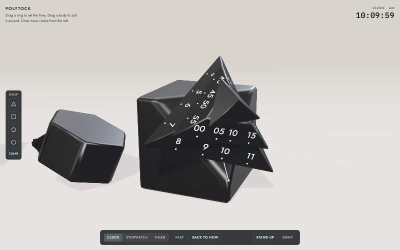
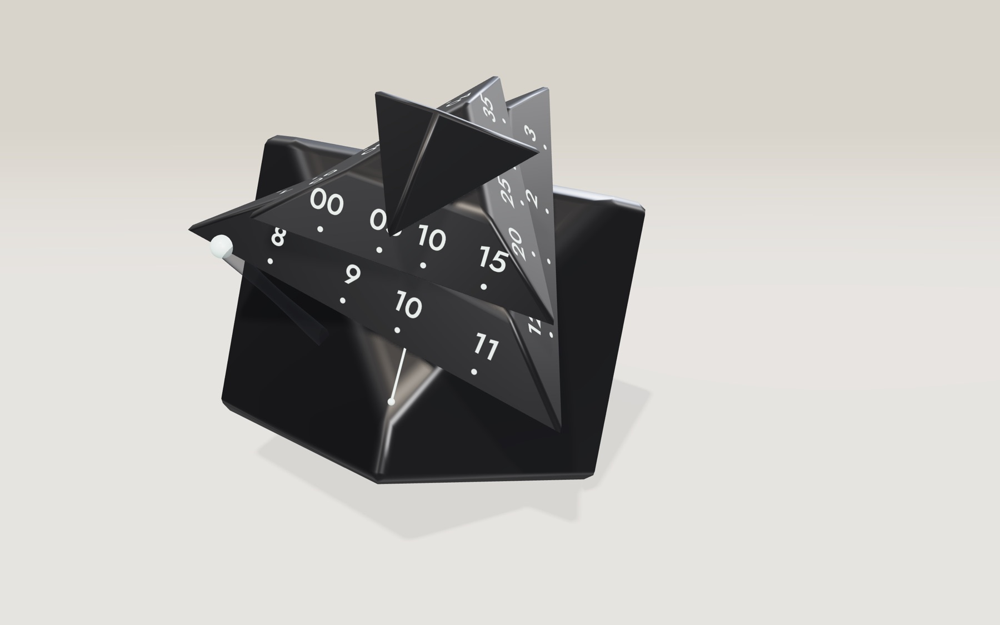
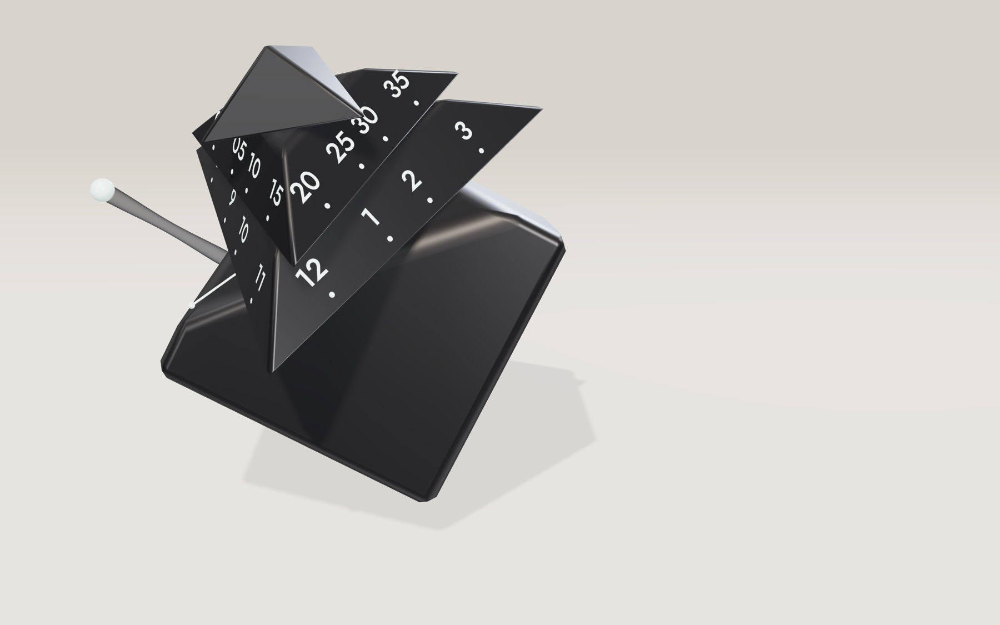
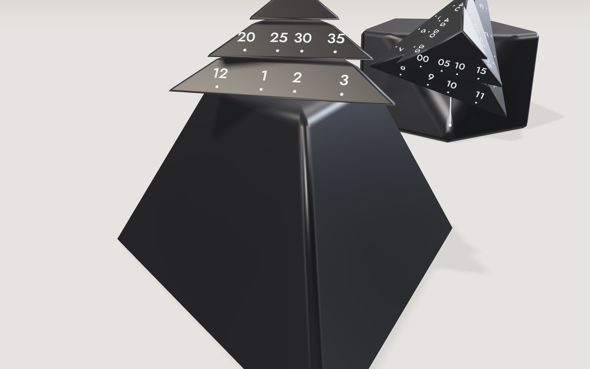
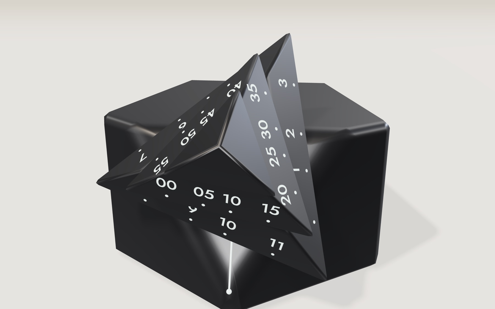
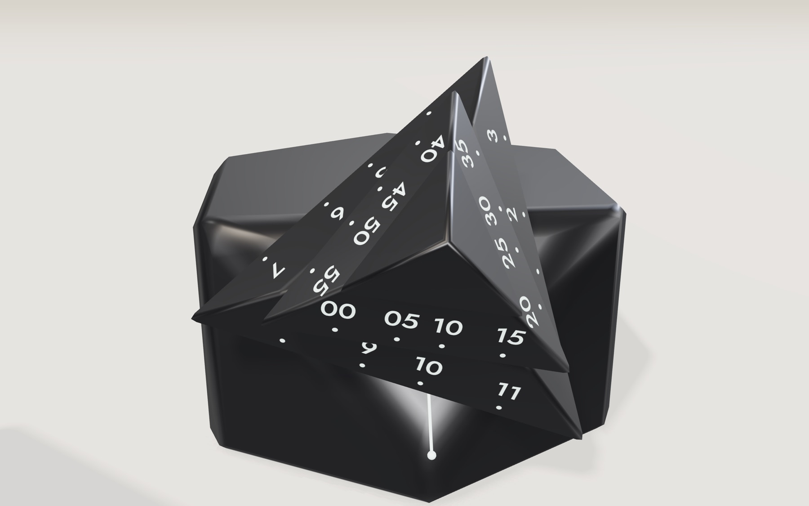
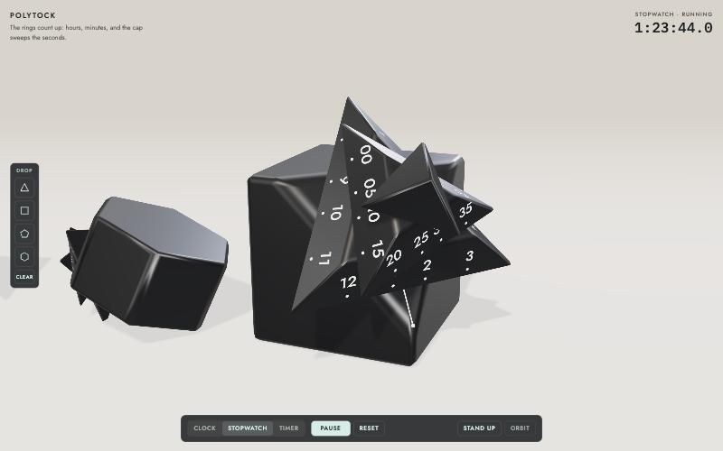
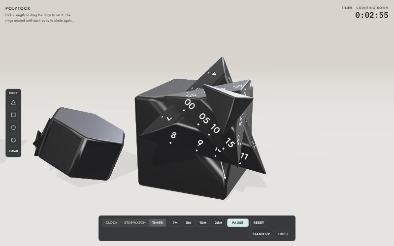

# Polytock

A clock you can pick up and throw. Polytock is a WebGL model of a black cube clock with one corner sliced off, where three stacked triangular rings turn on the cube's diagonal to show the hours, minutes and seconds. It runs in the browser with real physics, and it doubles as a stopwatch and a timer.

**Play it: [mpts.ie/games/polytock](https://mpts.ie/games/polytock/)**


## Reading the time

Look straight at the corner of the cube. A thin white line runs up the cut face from a dot on the front edge. That line is the pointer: the numeral on each ring that sits above it is the reading.

- The **lower ring** carries the hours, 12 to 11, four to a side.
- The **middle ring** carries the minutes in steps of five, 00 to 55.
- The **cap** on top sweeps once a minute, like a second hand.

The hour ring moves smoothly, so at 10:08 the pointer sits just past the 10, a little way toward 11.


| Three-quarter view | From above |
| --- | --- |
|  |  |

## What you can do

### Turn the rings by hand

Grab any ring and turn it. The ring follows your pointer and the time moves with it: the hour ring in hours, the minute ring in minutes and the cap in seconds. In clock mode a **Back to now** button appears once you have moved the time away from the real one. **Fast** runs one clock hour every six seconds so you can watch the rings go round.



### Pull it around

Grab a body (not a ring) and drag. A translucent grey tube stretches from the grab point to a ball under your pointer. The further you stretch it, the more the middle pinches in and the harder it pulls, up to a maximum force well above the clock's weight, so you can lift it, drag it and tip it over. Overstretch it past one and a half times its full-strength length and it snaps and lets go. **Stand up** puts the main clock back on its base.

| Gentle pull | Under tension |
| --- | --- |
|  |  |

### Drop in more clocks

The shelf on the left drops four more clocks into the scene: a triangular pyramid, a cube, a pentagonal prism and a hexagonal prism. Each one is a working clock with its own cut corner, pointer and ring stack, sized to its cut. They all keep the same time, they collide with each other, and you can pull any of them with the beam. **Clear** removes them.


| Pyramid | Cube |
| --- | --- |
|  |  |

| Pentagonal prism | Hexagonal prism |
| --- | --- |
|  |  |


### Stopwatch

Start, pause, resume and reset. The rings count up from 12:00 and the readout shows tenths of a second.



### Timer

Pick 1, 5, 10 or 25 minutes, or drag the rings to set any length up to twelve hours. The timer does not read against the pointer like the clock does. Instead the whole stack winds up and runs down:

1. **Set:** every ring sits 60° off the cut, which is as far out of line as a triangle can be. The rings and the cut make a six-pointed star.
2. **Running:** the rings turn back, the faster ones taking extra full turns on the way.
3. **Done:** the ring corners land on the corners of the cut, the stack closes the corner back up, and every body is whole again. The readout flashes and three short tones play.

| Wound | Halfway | Done |
| --- | --- | --- |
|  |  |  |

| Wound, from the side | Done, from the side |
| --- | --- |
|  |  |

Every clock in the scene winds and unwinds together.

| All clocks wound | All clocks done |
| --- | --- |
|  |  |



## How it is built

Everything is one HTML file with no build step. It loads [three.js](https://threejs.org/) for rendering and [cannon-es](https://github.com/pmndrs/cannon-es) for physics from jsDelivr.

### Geometry from planes

Every solid in the scene, from the bodies to each ring, is convex, so each is described as a list of planes. Corners are found by intersecting every three planes and keeping the points that sit inside all the others, then three's `ConvexGeometry` turns them into a mesh.

A clock is built from any such solid in the same way:

1. Pick a corner where exactly three faces meet.
2. Slice it off with a plane square to the line from the centre through that corner. The cut sits 48% of the way out, or further if a neighbouring corner would otherwise be caught.
3. Run the ring axis along that line. Size the rings to the cut triangle's incircle, place the pointer on the cut's lowest corner, and print the numerals so that a steady turn sweeps them past the pointer evenly (each label sits at `r·tan(α − φ)` along its flat side).

### Rounded edges without extra geometry

Each edge gets a narrow bevel plane at the bisecting angle. The bevel strips stay flat, but their vertex normals blend from one face's normal to the next, and the corner patches where bevels meet average every face they connect. The result shades like a smooth fillet with no extra triangles.


### Light

A soft-shadowed key light (variance shadow maps), a cool rim light, a hemisphere fill and a studio environment with long strip lights for the reflections that pick out the bevels.

### Physics

Each clock is a cannon-es body with two convex hulls: one for the body and one around the ring stack. The pull beam is a spring with damping applied at the grab point. Its force and its pinch both scale with the stretch, and both stop growing at full strength. The beam itself is a single cylinder reshaped in a vertex shader.

## Running it locally

Any static file server will do:

```bash
npx serve public
```

Or run it as the Cloudflare Worker it ships as:

```bash
npm install
npm run dev
```

## Deploying

The site is a Cloudflare Worker with static assets, routed at `mpts.ie/games/polytock`. The Worker strips the `/games/polytock` prefix and serves `public/`.

```bash
npm run deploy
```

## Layout

```
public/index.html   the whole app
src/worker.js       serves the app under /games/polytock
wrangler.jsonc      Worker, assets and routes
docs/images/        README images, rendered from the app
```
